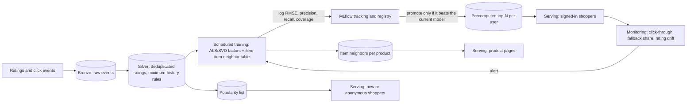

# Product recommendation system

Four ways to recommend electronics, compared on the same ratings data: popularity, user-user and item-item collaborative filtering (KNN), and matrix factorization (SVD). The answer was a **layered design, not a single winner**: SVD for personalization, item-item for explainable suggestions, and popularity for new shoppers. The most useful finding came from inspecting individual predictions, not averages.

| | |
|---|---|
| Technique | Recommender systems: popularity ranking, KNN collaborative filtering, SVD matrix factorization |
| Data | 65,290 ratings from 1,540 users on 5,689 products, filtered from a public Amazon Electronics dataset ([details](data/README.md)) |
| Result | Tuned SVD: RMSE 0.8808, F1@10 0.866. Best F1@10: tuned user-user KNN, 0.870 |
| Stack | Python, pandas, Surprise (KNNBasic, SVD, GridSearchCV), Matplotlib, seaborn |

> **Where the numbers come from.** Every number in this README comes from my original run of the analysis (Google Colab, 2026), copied from the executed notebook's outputs. I rebuilt the code into this repo afterward and have not yet re-run it on the real dataset, which isn't committed here. `make reproduce` re-runs everything on the real file and checks the results against [`results/reference_metrics.json`](results/reference_metrics.json).

## Business problem

An online store with a large electronics catalog wants to recommend products each shopper is likely to rate highly, based on their past ratings and on what similar shoppers liked. Good recommendations keep people engaged and buying; bad ones waste the most valuable space on the page. The system also has to serve brand-new shoppers with no history.

## Data

Amazon Electronics ratings (1 to 5 stars), 7,824,482 ratings in the raw file. To make collaborative filtering meaningful and computable, I kept users with at least 50 ratings and, among those, products with at least 5 ratings: **65,290 ratings from 1,540 users on 5,689 products**, no missing values. Ratings skew high: mean 4.29, median 5.

## Approach

| Approach | Strength | Weakness |
|---|---|---|
| **Popularity:** highest average rating, with a minimum number of ratings | Works for brand-new shoppers; simple | Same list for everyone |
| **User-user KNN:** recommend what similar shoppers liked | Personal; easy to explain | Needs enough overlapping neighbors |
| **Item-item KNN:** recommend items similar to ones the shopper liked | "Customers who liked this also liked..." | Same neighbor problem for sparse items |
| **SVD:** learn hidden taste factors for users and products | Best rating accuracy; always gives a personal estimate | Harder to explain |

**How I compared them:** an 80/20 split of ratings; RMSE for rating accuracy; precision, recall and F1 in each shopper's top 10, counting a product as relevant when its true rating is 3.5 or higher. Each model family was tuned with a 3-fold cross-validated grid search on RMSE.

1. **Popularity baseline** with a minimum-ratings rule (50 or 100), so a product with one five-star rating can't top the list.
2. **User-user and item-item KNN**, then tuned neighborhood size, minimum neighbors and the similarity measure.
3. **SVD**, then tuned epochs, learning rate and regularization.
4. **Inspected individual predictions**, which is where the most useful finding came from.

## Results

Test set, k = 10, relevance threshold 3.5. Source: original run.

| Model | RMSE | Precision@10 | Recall@10 | F1@10 |
|---|---|---|---|---|
| User-user KNN, baseline (cosine) | 1.0012 | 0.855 | 0.858 | 0.856 |
| User-user KNN, tuned (k = 50, min_k = 6, cosine) | 0.9526 | 0.847 | 0.894 | **0.870** |
| Item-item KNN, baseline (cosine) | 0.9950 | 0.838 | 0.845 | 0.841 |
| Item-item KNN, tuned (k = 30, min_k = 6, MSD) | 0.9576 | 0.839 | 0.880 | 0.859 |
| SVD, baseline | 0.8882 | 0.853 | 0.880 | 0.866 |
| **SVD, tuned** (20 epochs, learning rate 0.01, regularization 0.2) | **0.8808** | 0.854 | 0.878 | 0.866 |

**The finding that changed the design.** The KNN models' good average scores hid a problem. When a user-user or item-item model can't find enough neighbors, it doesn't fail: it returns the global average rating (4.29) and marks the prediction "impossible". The tuned user-user model did this for both of the example user-product pairs I checked, and the tuned item-item model's top five products for one example shopper were all this same fallback value. Because 4.29 is above the 3.5 relevance threshold, these generic guesses still count as relevant in precision and recall. A recommender that shows them would look fine in the metrics and feel random to the shopper.

The rebuilt code now measures this directly: every evaluation reports a **fallback share**, the fraction of test predictions that were global-average fallbacks. It wasn't measured in the original run; `make reproduce` will produce it.

**Recommendation: a layered recommender, not one model.**

- **Tuned SVD as the main personalized model:** the best rating accuracy (RMSE 0.8808, against 0.9526 for the best KNN model), F1@10 of 0.866, and it always produces a real personal estimate.
- **Item-item KNN for explainable "customers who liked this also liked..." picks,** only where it has real neighbors. Fallback predictions are dropped and SVD fills the slot.
- **Popularity for new or anonymous shoppers,** with a minimum-ratings rule.

[`recommend.layered_recommend`](src/recommender/recommend.py) implements this design. It is tested for correctness but not evaluated for quality; that needs an online experiment.

## Decisions and trade-offs

**Lead with SVD even though user-user KNN had the highest F1@10.** F1@10 ranked tuned user-user KNN first (0.870 vs 0.866); RMSE ranked SVD first (0.8808 vs 0.9526). I chose to combine models by role with SVD as the primary model: 0.004 lower headline F1 in exchange for real personal estimates everywhere, at the cost of more moving parts, each with a clear job.

**Drop "impossible" KNN predictions.** Keeping them makes the metrics look better; dropping them and backfilling from SVD means fewer item-item suggestions on sparse products but no generic guesses presented as personal.

**Filter to active users and rated products.** Without it, most users and products have no neighbors and the matrix doesn't fit in memory. The cost: the results describe engaged shoppers, not the long tail, which is exactly where the popularity layer matters.

**Known weaknesses**

- The grid searches ran on the full filtered dataset, so the tuning folds overlap the test split and the tuned models' test scores are somewhat optimistic. Next time I'd tune on the training split only.
- A random split lets models see a shopper's later ratings. A time-based split would match real use.
- With ratings this high, a "predict the average" baseline would score well on precision and recall; I haven't measured it yet.

**What I changed when I rebuilt the code:** seeded the tuning folds (the original run's folds were random, so tuned results may move slightly); rewrote the evaluation and recommendation helpers; added the fallback-share metric and the layered recommender.

## How to run

```bash
make setup && source .venv/bin/activate   # Python 3.12+; pinned versions tested on 3.14
make test                                 # unit tests on synthetic data
make demo                                 # full pipeline on synthetic data
# Real results: download ratings_Electronics.csv (data/README.md) to data/raw/, then
make reproduce                            # writes results/metrics.json and compares with the original run
make notebook                             # runs notebooks/product_recommender.ipynb top to bottom
```

`scikit-surprise` builds from source on some platforms and needs a C compiler.

## Repo layout

```
src/recommender/
  config.py       seeds, filters, k and threshold, search grids
  data.py         load the raw file; keep active users and rated products
  popularity.py   rank-based recommendations
  models.py       Surprise datasets, KNN and SVD, seeded grid search
  evaluate.py     RMSE, precision/recall/F1 at k, fallback share
  recommend.py    top-n lists and the layered recommender
  pipeline.py     end-to-end run and comparison with the reference run (CLI)
  synthetic.py    fake ratings with the real shape, for tests and demos
notebooks/product_recommender.ipynb   the comparison, step by step
results/reference_metrics.json        numbers from the original run
tests/                                pytest suite
```

## In production on Databricks (design)

This is how I would run it in production. It's a design, not something I have deployed.



- **Pipeline:** ratings and click events land in Delta tables; a Silver table applies the minimum-history rules and deduplicates.
- **Training:** a scheduled job retrains the factor model (Spark's ALS is the usual scalable choice for matrix factorization at full catalog size) and the item-item neighbor table; every run logged in MLflow with RMSE, precision, recall and coverage, and promoted only if it beats the current model.
- **Serving:** precompute top-N lists per user into a low-latency table; product pages read item-item neighbors; anonymous shoppers get the popularity list.
- **Monitoring:** track click-through on recommendations, the share of fallback predictions, and rating drift; alert when the fallback share rises.

## What I'd do next

- Add a "predict the average" baseline to set the bar every model must clear.
- Evaluate on a time-based split (train on older ratings, test on newer).
- Measure catalog coverage and novelty, not just accuracy, so the recommender doesn't keep showing the same bestsellers.
- Test the layered design online with an A/B test on click-through and purchases.

## About

I built this project in the AI & Data Science Program: Leveraging Responsible AI, Data and Statistics for Practical Impact (MIT IDSS, delivered through Great Learning), 2026. The analysis, code and write-up are my own. Code is MIT licensed; the dataset has its own terms (see [`data/README.md`](data/README.md)).
